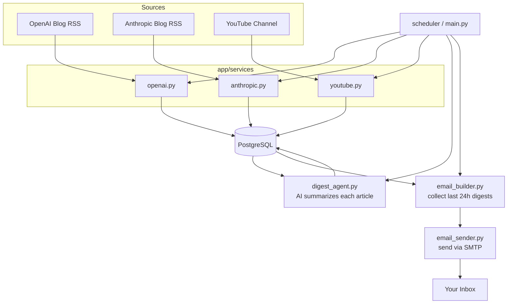

# AI News Aggregator

A personal pipeline that scrapes AI news from multiple sources, stores it in Postgres,
summarizes it with an AI agent, and emails a daily digest.

## Architecture



## Pipeline steps

1. **Scraping** — pull raw articles/videos from each source (RSS feeds are easiest to start with)
2. **Storage** — save raw items to Postgres, deduped by ID/URL so re-runs don't create duplicates
3. **Summarization** — an AI agent reads each article and writes a short summary + link
4. **Retrieval** — a query that pulls everything summarized in the last 24 hours
5. **Delivery** — format it and email it out

## Target file structure

This is the structure to build *toward*, not all at once — start with one scraper
printing to console before adding the rest.

```
AI News Aggregator/
├── pyproject.toml
├── .env                          # API keys, DB creds, email creds — never committed
├── .gitignore
├── main.py                       # entrypoint: runs the whole pipeline
└── app/
    ├── services/
    │   ├── openai.py              # fetch OpenAI blog RSS
    │   ├── anthropic.py           # fetch Anthropic blog RSS
    │   └── youtube.py             # fetch new videos from a channel
    ├── database/
    │   ├── models.py              # table definitions (articles, digests)
    │   ├── connection.py          # DB engine/session
    │   └── repository.py          # save/query functions
    ├── agent/
    │   └── digest_agent.py        # calls the LLM to summarize one article
    └── email/
        └── sender.py              # builds + sends the digest email
```

## Build order (milestones)

1. One source, print to console (no DB, no AI, no email) — prove scraping works
2. Add Postgres storage for that one source — prove persistence + dedup works
3. Add the AI summarization step for saved articles — prove the LLM call works
4. Add email delivery for one summarized article — full loop works end to end
5. Generalize: add remaining sources, then the 24-hour digest query
