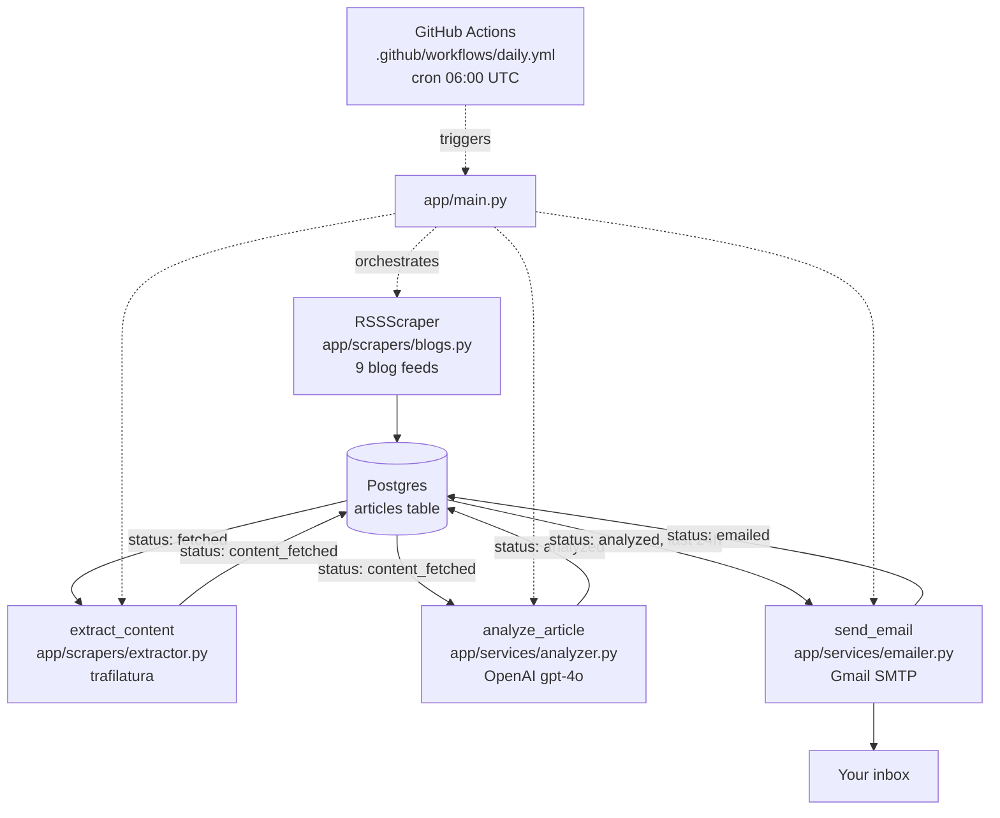

# Newscaster

Keeping up with AI and data is overwhelming when you work in the space. 
Too many blogs, too many releases, and most of it doesn't matter to me. 
I was either skimming everything and retaining nothing, or ignoring it all and finding out late.

So I built something to read it for me.

Newscaster runs every morning. It scrapes trusted AI and ML blogs, pulls the full text of each article, 
and has an LLM go through them the way an editor would. Then it emails me a digest grouped by article type 
and interesting angles in each article every morning.

This is an end-to-end project which is deployed and runs on its own.

## What the output looks like


## Architecture



## Pipeline steps

Each article moves through a status state machine stored right on its row
(`app/database/models.py:ArticleRow.status`):

1. **Scrape** — `RSSScraper` goes through given blog feeds, pulls their title, url, and published date.
2. **Save** (`fetched`) — articles metadata (title, url, published date) are saved in a postgres database.
3. **Extract** (`content_fetched`) — `trafilatura` is used to fetch the full article body.
4. **Analyze** (`analyzed`) — the full text goes to `gpt-4o` with a structured prompt
   that returns `story_type`, `specific_detail`, `angle`, `key_insight`, and `summary` as
   JSON.
5. **Email** (`emailed`) — analyzed articles from the last 24h are grouped by
   `story_type` (Releases, Deep dives, Explainers, Roundups, Commentary, Quick reads)
   and sent as an HTML + plain-text email via Gmail SMTP.

## Stack

| Concern | Choice |
|---|---|
| Language / tooling | Python 3.12, [uv](https://github.com/astral-sh/uv) |
| Scraping | `feedparser` (RSS) + `trafilatura` (full-text extraction) |
| Data validation | `pydantic` |
| Database | Postgres — local via `docker-compose` for dev, [Supabase](https://supabase.com) in production |
| ORM / migrations | SQLAlchemy 2.0 + Alembic |
| Analysis | OpenAI API (`gpt-4o`) |
| Delivery | `smtplib` → Gmail SMTP (HTML + plain-text multipart) |
| Scheduling | GitHub Actions cron (`.github/workflows/daily.yml`, daily at 06:00 UTC) |

## Project structure

```
newscaster-ai/
├── .github/workflows/daily.yml   # cron trigger, runs the pipeline in CI
├── alembic/                      # migrations
├── docker-compose.yml            # local Postgres for dev
├── app/
│   ├── main.py                   # entrypoint: runs the whole pipeline
│   ├── scrapers/
│   │   ├── blogs.py              # RSSScraper + the 9 feed sources
│   │   └── extractor.py          # full-text extraction via trafilatura
│   ├── database/
│   │   ├── models.py             # ArticleRow (single table, status state machine)
│   │   ├── database.py           # engine/session, reads DATABASE_URL
│   │   ├── repository.py         # save/query/update functions
│   │   └── create_tables.py      # one-off table bootstrap (superseded by Alembic)
│   └── services/
│       ├── analyzer.py           # OpenAI call + editorial prompt
│       └── emailer.py            # HTML/text email building + sending
```

## Running locally

```bash
uv sync
docker compose up -d          # local Postgres on :5434
uv run alembic upgrade head    # create/update schema
uv run python -m app.main      # run the pipeline once
```

Required environment variables (`.env`, not committed):

```
DATABASE_URL=
OPENAI_API_KEY=
EMAIL_ADDRESS=
EMAIL_APP_PASSWORD=
EMAIL_TO=
```

## Known limitations

- OpenAI's article pages block `trafilatura` (HTTP 403), so those articles stay at `fetched` and are retried on each run.
- It has one user (me). Sources and the email recipient are set in code and environment variables, not per user.

## Deployment

GitHub Actions (`.github/workflows/daily.yml`) runs `uv run python -m app.main` daily
at 06:00 UTC (and on-demand via `workflow_dispatch`), against a Supabase Postgres
instance. Secrets (`DATABASE_URL`, `OPENAI_API_KEY`, `EMAIL_ADDRESS`,
`EMAIL_APP_PASSWORD`, `EMAIL_TO`) are stored as GitHub Actions repo secrets.
